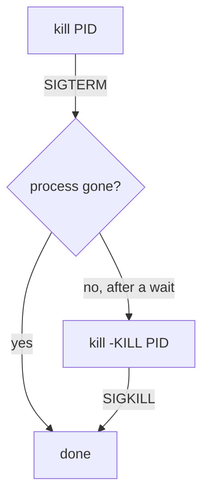

# Signals And Stopping Processes

Astronaut, an order shouted to a crew member is a **signal**. This part shows how to send the right one, and why the polite order sometimes does nothing.

## Sending a signal with kill

Despite its name, `kill` only sends a signal. The default signal asks the process to finish up and leave.

<!-- astrona:playground:renew -->

Here is a real example. List the signal names on this machine:

```bash
# shell: any user
kill -l
```

The output is a list of names with numbers. You can use the name or the number. Names are safer, because a few numbers differ between computer architectures.

### The five signals to know

| Signal | Plain meaning | Can the process ignore it? |
| --- | --- | --- |
| `SIGTERM` | "Finish up and leave." This is the default of `kill`. | Yes |
| `SIGKILL` | "Out of the airlock now." The kernel ends the process. | No |
| `SIGHUP` | "Hang up." Many daemons read their configuration again. | Yes |
| `SIGSTOP` | "Freeze." The process stops until it is told to continue. | No |
| `SIGCONT` | "Carry on." Continues a stopped process. | Yes |

The kernel, the reactor core, handles `SIGKILL` and `SIGSTOP` itself. The crew member never sees them, so they cannot catch or ignore them.

### See it in your playground

Find the stubborn crew member, then send the default signal:

```bash
# shell: any user with sudo
PID=$(pgrep -f stubborn.sh | head -1)
sudo kill "$PID"
ps -p "$PID" -o pid,stat,comm
```

`stubborn.sh` is written to ignore `SIGTERM`, so `ps` still lists it. Now send the signal it cannot ignore:

```bash
# shell: any user with sudo
sudo kill -KILL "$PID"
ps -p "$PID" -o pid,stat,comm
```

This time `ps` prints only its heading line, because the process is gone.

## Why the order matters

Use `SIGTERM` first. It lets the program close files and remove its lock files. Use `SIGKILL` only when `SIGTERM` has failed after a fair wait, because a killed program gets no chance to clean up.



The diagram shows that a polite `SIGTERM` comes first and `SIGKILL` is the last step.

## Stopping many processes by name

`pkill` and `killall` look the process up for you:

```bash
# shell: any user with sudo
sudo pkill -f cpuburn.sh
sudo killall crew-sleeper.sh
```

`pkill` matches a pattern against the process name, or against the whole command line with `-f`. `killall` matches the exact process name. Both send `SIGTERM` unless you add a signal such as `-KILL`. Run `pgrep -a` with the same pattern first, to see who would be hit.

### Pause and continue

`SIGSTOP` freezes a process without ending it, and `SIGCONT` lets it go on:

```bash
# shell: any user with sudo
sudo pkill -STOP -f cpuburn.sh
ps -eo pid,stat,comm | grep cpuburn
sudo pkill -CONT -f cpuburn.sh
```

The state letter of the frozen process is `T`. After `SIGCONT` it returns to `R`.

If you ended a crew member in your playground and want it back, run `sudo crew-restart`. It starts all three again.

## Common pitfalls

> [!WARNING]
> - **Using `kill -9` first.** The program cannot clean up. Try `SIGTERM` and wait.
> - **A pattern that matches too much.** `pkill -f python` ends every Python program. Check with `pgrep -af` first.
> - **Reading `SIGSTOP` as "stopped for good".** The process is only frozen. It still exists and holds its memory.

*`kill` sends signals: `SIGTERM` asks, `SIGKILL` forces, `SIGSTOP` freezes and `SIGCONT` resumes.*
