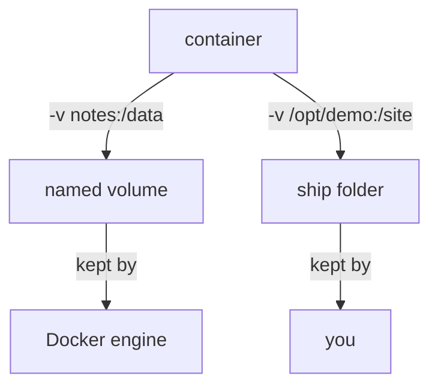

# Volumes And Bind Mounts

Astronaut, a pod's own floor is wiped when the pod is removed. If a pod must keep cargo, you cut a hatch between it and one of the ship's cargo holds. Docker offers two kinds of hatch: a **named volume**, a cargo hold that Docker builds and looks after, and a **bind mount**, a hatch to a folder of your own choosing on the ship.

## One real example: the data that survives

Start with a case you can run. You write a file inside a container, remove the container, and find the file again.

<!-- astrona:playground:renew -->

### See it in your playground

Create a named volume and start a container that mounts it at `/data`:

```sh
docker volume create notes
docker run -d --name keeper -v notes:/data alpine sleep 3600
```

Write a file into the volume from inside the container, then remove the container completely:

```sh
docker exec keeper sh -c 'echo "log entry one" > /data/log.txt'
docker rm -f keeper
```

Start a new container on the same volume and read the file:

```sh
docker run --rm -v notes:/data alpine cat /data/log.txt
```

The file is still there. The container `keeper` is gone, but the volume `notes` was never part of it.

## The rule

A named volume is a cargo hold managed by the Docker engine. It lives apart from every container. `docker rm` removes the pod and leaves the volume. Only `docker volume rm notes` (or a prune) deletes the volume and its data.

### Look at your volumes

Three commands cover the daily work:

```sh
docker volume ls
docker volume inspect notes
docker volume rm notes
```

`docker volume ls` lists the volumes. `docker volume inspect` prints the record of one volume, including its `Mountpoint`, the folder under `/var/lib/docker/volumes/` where Docker keeps the data. `docker volume rm` fails while a container still uses the volume, and that is a useful guard.

## Bind mounts

A **bind mount** connects a folder that already exists on the ship to a path in the pod. Docker does not manage it, so the data lives exactly where you put it, and `docker volume ls` does not list it.

### Compare the two spellings

The short option `-v` and the long option `--mount` both work. The long form says what each part means, which makes mistakes easier to spot.

```sh
docker run -d --name site -v /opt/demo/status-page:/usr/share/nginx/html:ro nginx:alpine
docker run -d --name site2 --mount type=bind,source=/opt/demo/status-page,target=/usr/share/nginx/html,readonly nginx:alpine
```

In `-v`, the first part is a path (bind mount) or a name (named volume), and the second part is the path inside the pod. `:ro` makes the hatch read-only. With `--mount`, a bind mount names a `source` folder that must already exist, or Docker stops with an error. With `-v`, Docker creates a missing source folder as `root`, which is a classic trap.

### Which one to choose

Use a named volume for data that belongs to the container, such as a database. Use a bind mount when you want to edit files on the ship and see them in the pod at once, such as a web page.



The diagram shows that a named volume is looked after by the Docker engine and a bind mount is a plain folder that you look after yourself.

### Read the mounts back

`docker inspect` shows what the engine really mounted. The first line shows the type, the second the volume name:

```sh
docker inspect --format '{{ range .Mounts }}{{ .Type }} {{ .Source }} {{ .Destination }}{{ println }}{{ end }}' site
```

For a bind mount the type is `bind`. For a named volume the type is `volume` and the record also has a `Name`.

## Common pitfalls

> [!WARNING]
> - **Thinking `docker rm` deletes the volume.** It does not. The data waits in the volume until `docker volume rm`.
> - **A mistyped volume name.** `-v notse:/data` quietly creates a new empty volume called `notse`. Check with `docker volume ls`.
> - **A relative path in `-v`.** `-v data:/data` is a volume named `data`, not the folder `./data`. A bind mount needs an absolute path.
> - **A bind mount over a folder with content.** The mount hides what the image had at that path.

*A named volume is a cargo hold Docker looks after and it outlives the container; a bind mount is your own folder; remove containers with `docker rm` and volumes only with `docker volume rm`.*
