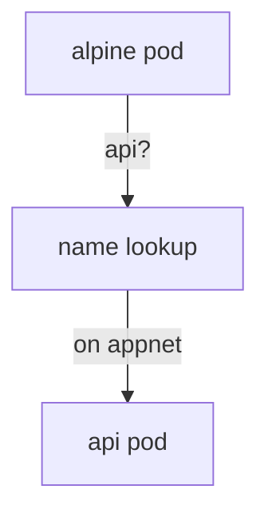

# Networks, Logs And Exec

Astronaut, pods docked to the ship talk to each other over a radio network. Docker gives you a default network and lets you build your own. This part shows how pods find each other by name, how to read a pod's flight log, how to step inside it, and how to clean up without removing too much.

## One real example: finding a pod by name

Start with a case you can run. You start a web pod on a network of your own, and a second pod reaches it by its name.

<!-- astrona:playground:renew -->

### See it in your playground

Create the network and start the web pod on it:

```sh
docker network create appnet
docker run -d --name api --network appnet nginx:alpine
```

Start a second pod on the same network and ask the first one for its page, using only its name:

```sh
docker run --rm --network appnet alpine wget -qO- http://api
```

The reply is the nginx welcome page. The second pod found `api` by name. Docker's own name lookup service on the user-defined network answered.

## The rule

On a **user-defined network**, Docker runs a name lookup, so containers find each other by container name. The **default bridge** network does not do this for container names. On the default bridge, containers can only reach each other by IP address, which can change.



The diagram shows that the second pod asks the name lookup of the network, which answers with the address of the `api` pod.

### Read a network

These commands list networks and show who is on one:

```sh
docker network ls
docker network inspect appnet
```

`docker network inspect` prints the subnet and, under `Containers`, each pod on the network with its address. A pod can join a running network too, with `docker network connect appnet <name>`.

## Port mappings, again

A user-defined network connects pods to each other. It does not open the ship's radio channels. To reach a pod from outside, you still publish a port with `-p <host>:<container>`. The host port is always on the left.

## The pod's flight log and the way inside

`docker logs` prints what the main process of a pod wrote to its output. `docker exec` runs a new command inside a running pod.

### Read logs and step inside

```sh
docker logs --tail 5 api
docker logs -f api
docker exec -it api sh
```

`--tail 5` prints the last five lines. `-f` follows the log until you press Ctrl+C. `docker exec -it api sh` opens a shell inside `api`: `-i` keeps the input open and `-t` gives you a terminal. Type `exit` to leave. The pod keeps running.

## Cleaning up

Docker keeps stopped containers and unused images until you remove them. List every container, running or not, then remove the ones you no longer need.

```sh
docker ps -a
docker rm -f api
docker rmi status-page:1.0
docker network rm appnet
```

`docker rm -f` stops and removes a pod. `docker rmi` removes an image, and it refuses while a container still uses it. `docker network rm` refuses while a pod is still on the network. `docker system prune` removes all stopped containers, unused networks and dangling images in one go, so read what it lists before you say yes.

## Common pitfalls

> [!WARNING]
> - **Expecting name lookup on the default bridge.** It works only on a network you created.
> - **Using `docker exec` on a stopped pod.** The pod must be running. Check with `docker ps -a`.
> - **Running `docker system prune` without reading.** It deletes things that only look unused.
> - **Forgetting that `docker logs` shows only the main process.** A command you run with `docker exec` writes to your terminal, not to the log.

## Your mission: Container Images, Volumes And Networks Lab

You can now build an image from a `Dockerfile`, keep data in a named volume, and put a container on a network of your own. The mission asks you to do all three on one fresh training ship.

The mission runs on its own training ship. Pause your playground first:

```sh
astrona stop container-build-bay
```

Then start the mission and open a terminal on it:

```sh
astrona run --git git@github.com:astrona-io/ATS002.git -c sections/section-020/module-05/labs/lab-01
astrona ssh ats-002-lab-025
```

Read the task in [`question.md`](./labs/lab-01/question.md) and solve it on your own first. When you think you are done, send it for grading:

```sh
astrona submit -c sections/section-020/module-05/labs/lab-01
```

When the mission is done, remove it and start your playground again:

```sh
astrona destroy ats-002-lab-025
astrona start container-build-bay
```

*Pods on a user-defined network find each other by name; `docker logs` reads the flight log, `docker exec -it` steps inside, and `docker rm`, `docker rmi` and `docker volume rm` each remove only their own kind of thing.*
