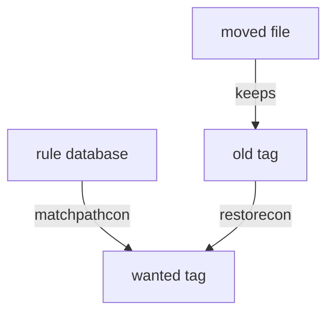

# Contexts And restorecon

Astronaut, this part is a worked walkthrough. The commands are for a RHEL-family machine, and your Ubuntu training ship cannot run SELinux. Read each command, learn what it does, and write the sequences in your notes file. Results are described in words, and nothing here shows output from your ship.

## Reading the tags

SELinux gives every process and file a security tag called a **context**. It has four fields: `user:role:type:level`. The **type** is the field that the rules really use.

<!-- astrona:playground:renew -->

### See it in your playground

Save this as `/root/selinux-notes.sh`:

```bash
getenforce
ls -Z /srv/web
ps -Z
id -Z
```

Then check the syntax of the file:

```sh
bash -n /root/selinux-notes.sh
```

On a RHEL-family machine, `getenforce` prints the mode (`Enforcing`, `Permissive` or `Disabled`). `ls -Z` adds the context of each file, `ps -Z` the context of each process, and `id -Z` the context of your own shell. On your ship, `bash -n` is silent when the syntax is fine. That tells you nothing about SELinux.

## A moved file keeps its old tag

A new file gets the tag that the folder's rule gives it. A **moved** file keeps the tag it already had. A **copied** file is a new file, so it gets the tag of its new place.

Here is a real case. A page is moved with `mv /home/pilot/index.html /srv/web/`. It keeps the tag of a home folder, and the web server is refused. A copy with `cp` would have got the web content tag.

The command `matchpathcon /srv/web/index.html` prints the tag that the rules say the file should have. The command `restorecon -Rv /srv/web` sets every file below the folder to that tag and, with `-v`, prints each change it makes. Which tag is right depends on the rules in the policy, not on you.



The diagram shows that `restorecon` replaces the old tag with the tag the rule database wants.

## Temporary and lasting fixes

The command `chcon -R -t httpd_sys_content_t /srv/web` changes the tag right now. It writes no rule, so the next relabel puts the old tag back.

The lasting fix has two steps. First `semanage fcontext` writes a rule into the rule database. Then `restorecon` applies it. Save this as `/root/selinux-notes.sh`:

```bash
semanage fcontext -a -t httpd_sys_content_t "/srv/web(/.*)?"
restorecon -Rv /srv/web
```

Then check the syntax of the file:

```sh
bash -n /root/selinux-notes.sh
```

The pattern `"/srv/web(/.*)?"` matches the folder and everything below it. Keep the quotes, so the shell does not touch the pattern. `semanage` is the engineer who writes the rule on the duty card, and `restorecon` is the one who stamps the files.

## Common pitfalls

> [!WARNING]
> - **Using `chcon` alone.** It works now and is undone by the next relabel. Write the rule with `semanage fcontext` first.
> - **Skipping `restorecon`.** `semanage fcontext` only writes the rule. Existing files keep their old tag until `restorecon` runs.
> - **Forgetting the quotes around the pattern.** The shell can change `(/.*)?` before `semanage` sees it.
> - **Believing `mv` fixes the label.** A moved file keeps its old tag.

*A tag is user:role:type:level; `mv` keeps the old tag; `chcon` is for now; `semanage fcontext` plus `restorecon` is for good.*
