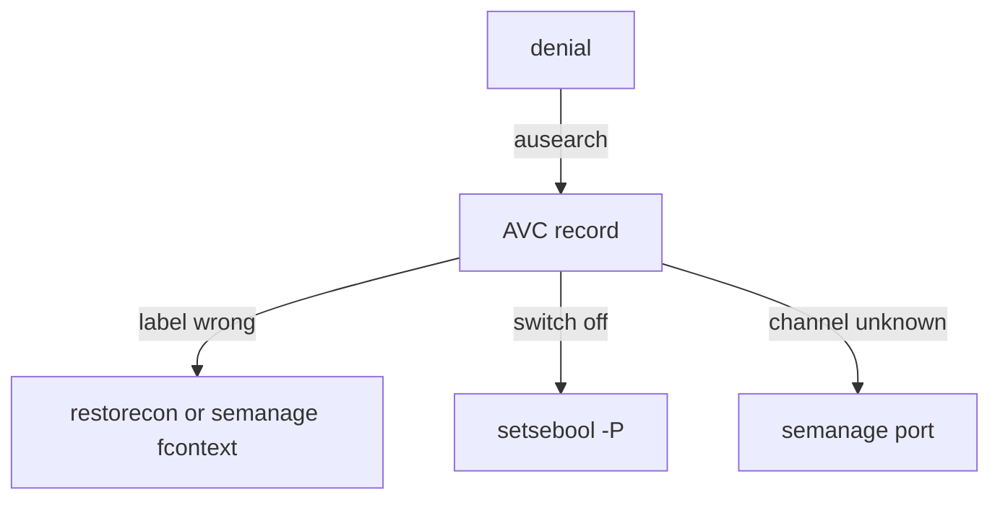

# Booleans, Ports And Reading Denials

Astronaut, this part is a worked walkthrough for a RHEL-family machine. Your ship cannot run SELinux, so you write the commands in your notes file and read what each one does. Nothing here shows output from your ship.

## Switches and radio channels

Some SELinux rules ship with an on and off switch, called a **boolean**. A boolean lets you allow a whole behaviour, such as "the web server may open outgoing connections", without writing a new rule. A **port type** is the tag on a radio channel: a service may only listen on channels that carry a tag it knows.

<!-- astrona:playground:renew -->

### See it in your playground

Save this as `/root/selinux-notes.sh`:

```bash
getsebool -a
getsebool httpd_can_network_connect
semanage boolean -l
setsebool -P httpd_can_network_connect on
semanage port -l | grep http
semanage port -a -t http_port_t -p tcp 8888
```

Then check the syntax of the file:

```sh
bash -n /root/selinux-notes.sh
```

What each line does on a RHEL-family machine:

- `getsebool -a` lists every boolean and its value. `getsebool <name>` shows one.
- `semanage boolean -l` lists booleans with a short description.
- `setsebool -P httpd_can_network_connect on` turns the switch on **and writes it to disk**, so it stays after a reboot.
- `semanage port -l | grep http` shows which ports already carry an HTTP tag.
- `semanage port -a -t http_port_t -p tcp 8888` adds TCP port 8888 to the web server's allowed channels, for good.

Without `-P`, `setsebool` changes only the running policy. The value is lost at the next reboot.

## Reading a denial

When SELinux refuses something, the audit log keeps an **AVC record** (access vector cache). That is the security chief's report of a tag that did not match. The audit daemon writes it, and `ausearch` reads it:

```sh
ausearch -m avc -ts recent
```

The command lists recent AVC records. Read the source type, the target type and the action. Then the command `audit2why` can explain a record in words. Send the record into it, for example `ausearch -m avc -ts recent | audit2why`.

## Modes and the relabel

SELinux has three states. **Enforcing** blocks and logs. **Permissive** only logs. **Disabled** is off.

`setenforce 0` switches to permissive until the next reboot. It is a test, and it also shows whether SELinux causes a problem. The line `SELINUX=` in `/etc/selinux/config` sets the mode used at boot.

After a long time with SELinux off, files have no tags. Create the marker file with `touch /.autorelabel` and reboot, and the system relabels every file at start-up.



The diagram shows that one AVC record points to one of three fixes: a label, a boolean or a port.

## Common pitfalls

> [!WARNING]
> - **Leaving out `-P`.** The boolean is back to its old value after a reboot.
> - **Using `setenforce 0` as a fix.** It only hides the problem until the next reboot. Find the AVC record and fix the cause.
> - **Searching the AppArmor log.** SELinux denials are AVC records in the audit log, not `apparmor="DENIED"` lines.
> - **Adding a port with a made-up type.** Use `semanage port -l` to see which type the service already uses.

## Your mission: SELinux Fix Script Lab

You can now name the three fixes for an SELinux refusal and write each as a command. The mission asks you to write the full command sequence for one scenario into `/root/selinux-fix.sh`. It grades your script, not a live SELinux system.

The mission runs on its own training ship. Pause your playground, then start the mission and open a terminal on it:

```sh
astrona stop selinux-commands-bay
astrona run --git git@github.com:astrona-io/ATS002.git -c sections/section-040/module-02/labs/lab-01
astrona ssh ats-002-lab-043
```

Read the task in [`question.md`](./labs/lab-01/question.md) and solve it on your own first. When you think you are done, send it for grading:

```sh
astrona submit -c sections/section-040/module-02/labs/lab-01
```

When the mission is done, remove it and start your playground again:

```sh
astrona destroy ats-002-lab-043
astrona start selinux-commands-bay
```

*A denial is a label, a switch or a channel: `restorecon`, `setsebool -P` or `semanage port`; `-P` and `semanage` make it last.*
